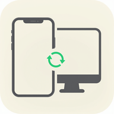

<p align="center"></p>

<h1 align="center">ClipSync for Android</h1>

<p align="center">
  <b>手机验证码 & 剪贴板 → 电脑端实时同步，通知横幅一键复制。</b><br/>
  <a href="README.md">简体中文</a> ·
  <a href="README.en.md">English</a> ·
  <a href="README.ja.md">日本語</a>
</p>

---

ClipSync 是一套自建的跨端消息同步工具。本仓库是 Android 客户端，使用 **Kotlin + OkHttp + WebSocket** 开发，以**前台保活服务**形态在后台常驻。

核心场景：**手机上收到验证码或复制了内容后，Windows / macOS 上立即弹出通知，一键复制验证码或全文；反之，电脑上复制的内容也能实时写回手机剪贴板。**

不依赖任何第三方推送服务（FCM / 小米 / 华为推送均不使用），通信走你自己的 WebSocket 中转，端到端加密可选，隐私自主可控。

> 最低系统：**Android 7.0（API 24）** · targetSdk：**35** · 语言：**Kotlin 2.0** · 构建：**Gradle 8.9 + AGP 8.7**

---

## 🌐 公共服务端（默认已配置）

本客户端默认 `serverURL` = **`wss://www.95qw.com`**，**下载安装后无需任何配置**，注册账号即可使用。

- 如果你要连**自建实例**：打开「设置 → 服务器地址」，改成 `wss://你的域名`（**不要**带路径，路径在反代里）；
- 如果你要**完全离线 / 内网**：服务端 Docker 一行起，详见 [ClipSync-Server 部署文档](https://github.com/JH-Clipsync/ClipSync-Server#-反向代理与路径规划)。
- 调试用本地服务：在 `local.properties` 里加 `clipsync.server=ws://你的内网IP:8080`，Gradle 重新构建即可。

---

## ✨ 核心功能

| 模块 | 说明 |
|------|------|
| 🔐 **账号密码登录** | 用户名 + 密码认证，首次连接自动换取 Token；Token 过期自动用本地保存的账密重新登录 |
| 👥 **在线设备列表** | 主页实时显示同账号下的在线设备、平台 / IP / 设备 ID / 上线时间 / 能力标签 |
| 🛡️ **端到端加密** | AES-256-GCM 加密，PBKDF2-HMAC-SHA256（20 万轮）派生密钥；设置页显示密钥指纹 |
| 📩 **短信验证码自动同步** | `SmsReceiver` 广播优先；MIUI/HyperOS 等拦截短信广播的机型，由 `NotificationSmsListener` 读通知栏兜底 |
| 🪟 **通知监听兜底** | 读取系统短信通知，自动回查 SMS 数据库拿完整原文；含看门狗，检测到假活自动重绑 |
| 📋 **剪贴板双向同步** | 无障碍服务在后台读取 / 写入剪贴板，文本与图片均支持；可分别配置自动上行 / 自动下行 |
| 📤 **分享菜单推送** | 任意 App 中「分享 → ClipSync」可手动把文本 / 图片推送到电脑，绕开后台剪贴板限制 |
| 🔔 **前台服务保活** | `SyncService` 以 `foregroundServiceType="dataSync"` 运行，常驻通知栏，降低被系统杀死概率 |
| 🚀 **开机自启** | 监听到开机 / 应用更新 / 快速启动广播；遵循「用时打开」原则，由用户在主页手动启动同步 |
| 🇨🇳 **国产 ROM 保活适配** | MIUI/HyperOS 的「通知类短信」「后台弹窗」「电池无限制」「通知使用权真连接」专项检测与引导 |
| 🔄 **自动重连** | 网络抖动 / Token 失效自动重连，指数退避；连接参数变更自动重启服务 |
| 📜 **消息历史** | 短信与剪贴板分类持久化，各保留最近 200 条，支持查看、复制、删除、清空 |
| 📖 **地址 / 错误可复制** | **主页连接卡上的服务器地址长按可复制**（系统复制菜单）；连接失败、验证码识别失败等弹窗文案一律可选中可复制，方便发工单 / Issue |
| 🖼️ **图片压缩** | 分享 / 剪贴板图片自动压缩为 JPEG，最长边 1600px、质量 80%，大图也不会卡住 |
| ⚙️ **设置页** | 服务器地址、账号、端到端加密、剪贴板开关、权限引导、历史记录、版本信息 |

---

## 🖼️ 界面预览

| 页面 | 说明 |
|------|------|
| 主页 | 同心光环连接状态、服务器地址、剪贴板预览、在线设备列表、启动 / 停止同步按钮 |
| 设置 | 四组卡片：连接 / 端到端加密 / 剪贴板同步 / 其他（权限、历史、版本） |
| 权限页 | 完成度进度条 + 逐项检查，已就绪收敛成灰勾，未就绪提供一键跳转 |
| 历史 | 短信 / 剪贴板合并时间线，图片缩略图，支持复制与删除 |

---

## 📦 下载安装

前往 [GitHub Releases](https://github.com/JH-Clipsync/ClipSync-Android/releases) 下载最新的 `ClipSync-<版本>.apk`，在手机上允许「来自此来源的应用」后安装即可。

CI 同时会把 APK 打包成 OCI 容器镜像推送到 GitHub Packages：

```
ghcr.io/<owner>/clipsync-android:<版本>
ghcr.io/<owner>/clipsync-android:latest
```

APK 位于镜像内 `/app/clipsync-android.apk`，可用 `docker cp` 取出，方便自建分发。

> 应用未上架 Google Play，也未做厂商商店上架；首次安装时系统可能提示「未知来源」，属于正常现象。

---

## 🚀 快速开始

1. 安装 APK 并打开 ClipSync
2. 在首页或设置中填写：
   - **服务器地址**（如 `192.168.1.10:8080`，支持 `ws://` / `wss://`）
   - **用户名 / 密码**（由服务端管理员分配，客户端不提供注册）
   - 是否启用**端到端加密**以及**同步密码**（需与电脑端一致）
3. 根据「权限」页提示逐项授权：
   - 短信 / 通知权限
   - 通知使用权（用于读取短信通知兜底）
   - 电池策略无限制（防止后台冻结）
   - MIUI/HyperOS 额外：通知类短信、后台弹窗
4. 返回主页点击「启动同步」，状态光环变绿即连接成功
5. 在 Windows / macOS 客户端登录同一账号即可互发消息

---

## 🧩 项目架构

```
ClipSync-Android/
├── app/src/main/java/com/clipsync/
│   ├── MainActivity.kt                    # 主页：状态光环、剪贴板预览、在线设备
│   │
│   ├── net/
│   │   ├── WsClient.kt                    # OkHttp WebSocket、心跳、自动重连
│   │   ├── AuthClient.kt                  # 用户名密码登录、Token 缓存
│   │   └── ServerAddress.kt               # 地址规范化
│   │
│   ├── service/
│   │   ├── SyncService.kt                 # 前台保活服务（dataSync）、消息分发
│   │   └── BootReceiver.kt                # 开机 / 更新广播占位
│   │
│   ├── sms/
│   │   ├── SmsReceiver.kt                 # SMS 广播接收器（首选通道）
│   │   ├── SmsDeduplicator.kt             # 广播与通知的去重
│   │   ├── PendingSmsQueue.kt             # 等连接就绪后再上行的队列
│   │   └── NotificationSmsListener.kt     # 通知使用权兜底 + 看门狗重绑
│   │
│   ├── accessibility/
│   │   └── ClipSyncAccessibilityService.kt # 无障碍服务，绕开后台剪贴板限制
│   │
│   ├── clip/
│   │   └── ShareActivity.kt               # 系统分享菜单入口（文本 / 图片）
│   │
│   ├── clipboard/
│   │   ├── ClipboardManagerHelper.kt      # 剪贴板读写 + 去重
│   │   ├── ClipReaderActivity.kt          # 透明 Activity，后台场景下触发读剪贴板
│   │   ├── ImageHelper.kt                 # 图片压缩（JPEG 80%、长边 1600px）
│   │   ├── ClipboardImageStore.kt         # 图片落盘缓存
│   │   ├── UploadDeduplicator.kt          # 上传去重（防止回环）
│   │   └── ScreenshotWatcher.kt           # 截图监听（可选）
│   │
│   ├── crypto/
│   │   ├── E2EECrypto.kt                  # AES-256-GCM + PBKDF2 底层
│   │   ├── EncEnvelope.kt                 # 加密信封数据结构
│   │   └── PayloadCipher.kt               # 业务报文加密封装 + 密钥缓存
│   │
│   ├── history/
│   │   └── HistoryStore.kt                # 本地历史（SharedPreferences + JSON）
│   │
│   ├── model/
│   │   └── Message.kt                     # SyncMessage / MessagePayload / OnlineDevice
│   │
│   ├── state/
│   │   ├── ConnectionBus.kt               # 全局连接状态 Flow
│   │   └── PresenceBus.kt                 # 在线设备列表 Flow
│   │
│   └── ui/
│       ├── SettingsActivity.kt            # 设置页
│       ├── PermissionSettingsActivity.kt  # 权限引导页
│       ├── PermissionStatus.kt            # 权限检测（含 MIUI 扩展项）
│       ├── HistoryActivity.kt             # 历史记录页
│       ├── Design.kt / DesignToast.kt / DesignDialog.kt / SettingsRows.kt
│       └── ThemeManager.kt
├── app/build.gradle.kts
├── app/src/main/AndroidManifest.xml
└── .github/workflows/release.yml          # GitHub Actions：构建 APK + Release + GHCR
```

### 技术栈

- **Kotlin 2.0** + **Coroutines**
- **OkHttp 4.12** + 原生 `WebSocket`
- **kotlinx.serialization**（JSON，无反射）
- **AndroidX AppCompat / Activity Result / Lifecycle**
- 纯代码 View（无 XML 布局、无 Compose），深色主题由 `ThemeManager` 接管
- 最低支持 **Android 7.0（API 24）**，targetSdk **35**

---

## 🔧 从源码构建

### 前置条件

- JDK 17（AGP 8.7 要求）
- Android SDK Platform 35 + Build-Tools 35.x
- Gradle 8.9（仓库自带 `gradlew`，会自动下载）

### 命令行

```bash
# 克隆仓库
git clone https://github.com/JH-Clipsync/ClipSync-Android.git
cd ClipSync-Android

# Debug 构建
./gradlew :app:assembleDebug

# Release 构建（无签名配置时会使用 debug 签名）
./gradlew :app:assembleRelease

# 产物
# app/build/outputs/apk/debug/app-debug.apk
# app/build/outputs/apk/release/app-release.apk
```

### 用 Android Studio

1. 使用 Android Studio Lady Gaga（2024.2.1）或更新版本打开项目
2. 等待 Gradle Sync 完成
3. 连接手机并开启 USB 调试，点击 ▶ 运行

### 自定义签名

在项目根目录创建 `local.properties`（已被 `.gitignore` 忽略），加入：

```properties
clipsync.storeFile=/绝对路径/your-release.jks
clipsync.storePassword=xxx
clipsync.keyAlias=clipsync
clipsync.keyPassword=xxx
clipsync.server=ws://192.168.1.1:8080
clipsync.token=
```

默认服务器地址、默认用户名、版本号等均可在 `app/build.gradle.kts` 的 `buildFeatures.buildConfig` 中调整。

---

## 🔐 权限说明

| 权限 | 用途 | 是否必须 |
|------|------|----------|
| `INTERNET` / `ACCESS_NETWORK_STATE` | 连接自建 WebSocket 服务器 | ✅ 必须 |
| `RECEIVE_SMS` / `READ_SMS` | 通过系统短信广播接收验证码；读最近 60 秒短信原文 | 推荐开启 |
| `POST_NOTIFICATIONS`（Android 13+） | 显示前台保活通知、同步状态通知 | ✅ 必须 |
| `READ_MEDIA_IMAGES`（Android 13+） / `READ_EXTERNAL_STORAGE` | 读取分享 / 剪贴板中的图片 | 图片同步需要 |
| `FOREGROUND_SERVICE` / `FOREGROUND_SERVICE_DATA_SYNC` | 以 `dataSync` 类型启动前台保活服务 | ✅ 必须 |
| `RECEIVE_BOOT_COMPLETED` | 开机后感知系统启动事件（默认不自动拉起服务） | 可选 |
| `REQUEST_IGNORE_BATTERY_OPTIMIZATIONS` | 引导用户把 App 加入电池白名单，防止后台冻结 | 推荐开启 |
| 通知使用权（`NotificationListenerService`） | MIUI/HyperOS 等拦截 SMS 广播时，从通知栏读取短信兜底 | 国产 ROM 推荐 |
| 无障碍服务（`AccessibilityService`） | 在后台读取 / 写入剪贴板（绕开 Android 10+ 后台剪贴板限制） | 剪贴板双向同步需要 |
| MIUI「通知类短信」「后台弹窗」 | 小米 / Redmi 机型上接收验证码、后台弹出通知的专属权限 | MIUI 推荐 |

> 所有权限都可在「设置 → 权限」页看到实时状态，未授予的项目会提供一键跳转按钮。

---

## 🐛 故障排查

| 现象 | 排查 |
|------|------|
| 连不上服务器 | 检查地址 / 端口、手机与服务器是否在同一网络；尽量用 `ws://IP:端口` 而非 `localhost`；若用 HTTPS 反代需用 `wss://` |
| 收不到验证码 | 1) 授予短信和通知权限；2) MIUI 在权限页开启「通知类短信」「后台弹窗」；3) 确认「通知使用权」开关为**已连接**状态（不只是已授权） |
| 通知使用权显示已授权但没反应 | MIUI 已知 bug，可在权限页点「重绑通知监听」，或关闭开关后重新打开；看门狗会每 10 分钟检测一次假活并自动重绑 |
| 短信重复推送 | `SmsReceiver` 与 `NotificationSmsListener` 双通道，去重器按发件人 + 5 分钟窗口去重；若仍重复请到 Issues 反馈日志 |
| 剪贴板不上行 | MIUI 等 ROM 对后台剪贴板做了限制；可开启无障碍服务，或使用系统「分享 → ClipSync」手动推送 |
| 服务经常被杀 | 在权限页把「电池策略无限制」开启；MIUI 额外在系统设置中锁定后台、允许自启动；关闭「神隐模式」 |
| 收到消息但解密失败 | 两端「同步密码」不一致，或一端未开加密；对照设置页的密钥指纹 |
| 图片同步失败 | 检查是否授予了图片 / 存储权限；图片过大时会被自动压缩，极端情况（大于 5MB）可能被服务端拒绝 |
| 开机后没有自动启动 | 按当前设计 BootReceiver 不自动拉起服务，避免干扰用户；请在主页点「启动同步」，或使用「启动时自动连接」 |

日志查看：

```bash
# 实时日志
adb logcat -s ClipSync SyncService WsClient SmsReceiver NotifSmsListener
```

---

## 🔐 隐私与安全

| 维度 | 设计 |
|------|------|
| 数据传输 | 走你自己的服务器，不经过任何第三方推送 / 统计 / 崩溃上报服务 |
| 数据存储 | 服务端不落库；Android 端数据存于应用私有目录（`/data/data/com.clipsync/`） |
| 账号信息 | 用户名、密码、Token 仅存于 `SharedPreferences`（`clipsync.xml`），用于自动重连 |
| 历史记录 | 短信与剪贴板各保留最近 200 条（SharedPreferences + JSON），可在应用内一键清空 |
| 短信内容 | 仅在收到短信的瞬间转发到你自己的其他设备；不会上传通讯录、不会上传历史短信 |
| 端到端加密 | AES-256-GCM；密钥由同步密码经 PBKDF2-HMAC-SHA256（20 万轮）派生，盐固定在客户端，从不上传 |
| 密钥缓存 | 多槽 LRU 缓存最多 4 把派生密钥，避免每条消息都跑 20 万轮 PBKDF2 |
| 权限最小化 | 不读通讯录、不读位置、不读相机 / 麦克风；仅在必要时读取短信和剪贴板 |
| 生产建议 | 服务端前用 Nginx / Caddy 加 TLS，客户端使用 `wss://` 地址 |

---

## 🤝 相关项目

| 项目 | 技术栈 | 链接 |
|------|--------|------|
| 服务端 | Go + gorilla/websocket | https://github.com/JH-Clipsync/ClipSync-Server |
| Windows 客户端 | .NET 8 + WPF | https://github.com/JH-Clipsync/ClipSync-Windows |
| macOS 客户端 | Swift + SwiftUI | https://github.com/JH-Clipsync/ClipSync-Mac |
| 服务管理后台 | Go + Gin | https://github.com/JH-Clipsync/ClipSync-Admin |
| 后台前端 | Vue 3 + Vite | https://github.com/JH-Clipsync/ClipSync-Admin-Web |

---

## 📄 License

个人自用项目，代码可自由参考修改。

---

**Made with ❤️ · 三端全自研 · 隐私归你自己**
